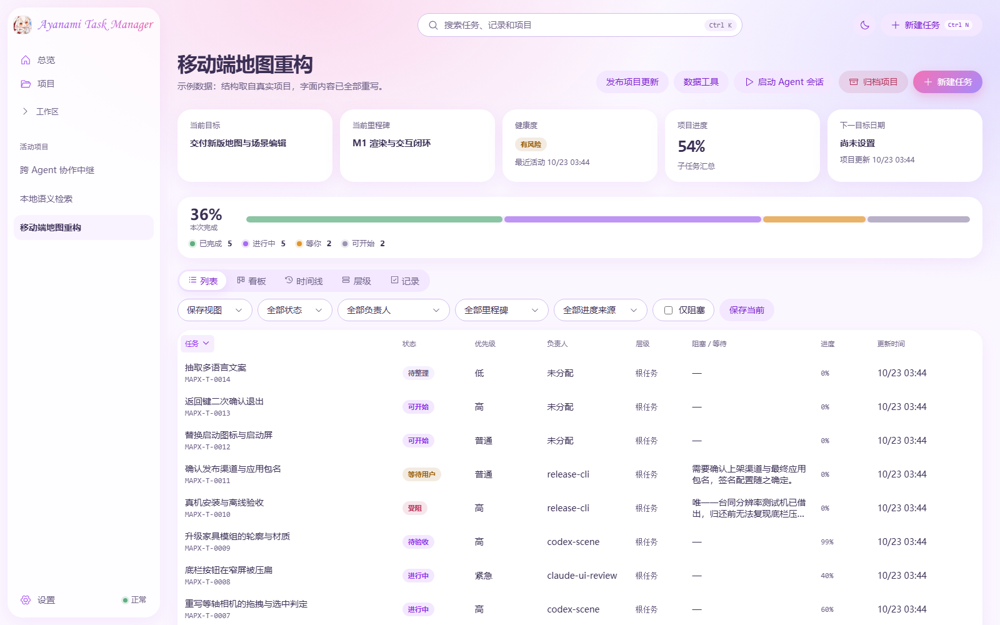
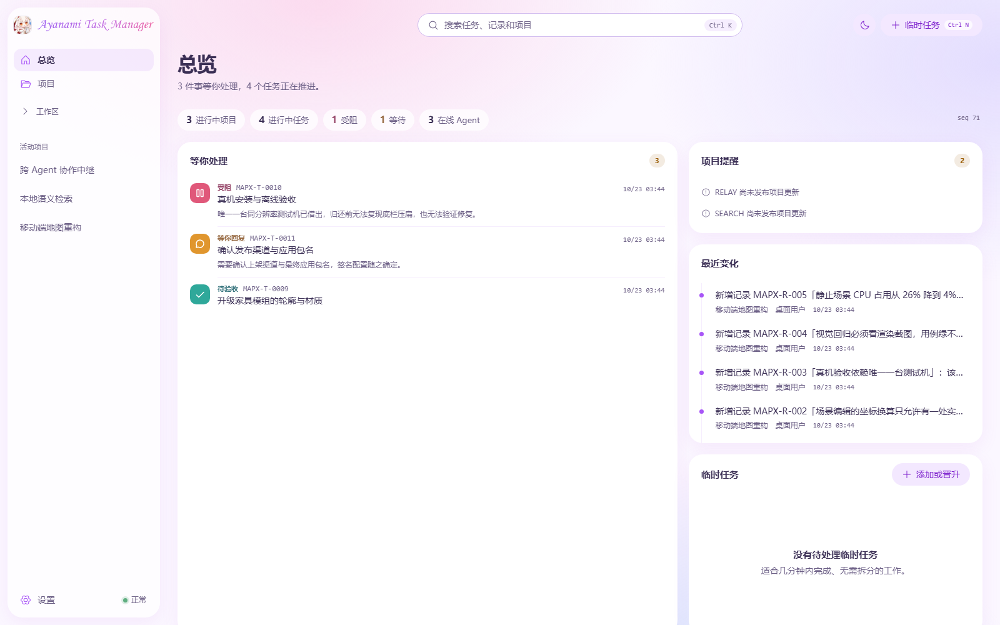
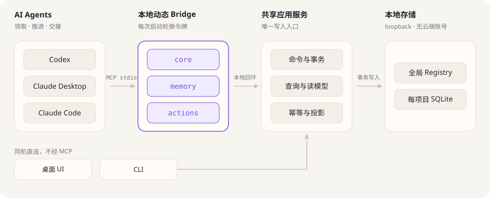

<div align="center">
  
  <h1>绫波任务管理器</h1>
  <p><strong>让 Codex、Claude、Kimi 与每一次开发 Session，共享同一份可信项目事实。</strong></p>
  <p>Local-first tasks, handoffs and shared knowledge for AI agents on Windows.</p>

  <p>
    <a href="https://github.com/ayanamislover/AyanamiTaskManager/releases/latest"></a>
    <a href="https://github.com/ayanamislover/AyanamiTaskManager/actions/workflows/ci.yml"></a>
    
    <a href="./LICENSE"></a>
  </p>

  <p>
    <a href="https://github.com/ayanamislover/AyanamiTaskManager/releases/latest"><strong>下载 3.0</strong></a>
    ·
    <a href="./docs/user-guide.md">用户指南</a>
    ·
    <a href="./docs/agent-integration.md">Agent 接入</a>
    ·
    <a href="./docs/security-model.md">安全模型</a>
    ·
    <a href="./docs/troubleshooting.md">排障</a>
  </p>
</div>

<br />

<div align="center">
  <picture>
    <source media="(prefers-color-scheme: dark)" srcset="./docs/assets/screenshot-project-dark.png" />
    
  </picture>
  <p><sub>示例数据：结构取自真实项目，字面内容全部重写。用 <code>pnpm exec tsx scripts/render-readme-screenshot.ts</code> 复现。</sub></p>
</div>

---

Agent 写代码不难，难的是**换一次 Session 就忘了项目到哪儿了**。上下文被压缩、进程重启、换一个 Agent 接手，项目历史只留在聊天记录里，每次开工都得重新翻一遍，翻完还未必翻对。

AyanamiTaskManager（ATM）把计划、任务、进度、阻塞、长期记录、证据和 Session 交接放进一个本地事实源。Agent 开工时读一份 brief 就能接着做。它不保存整段对话，只留下会影响项目推进的结构化事实。桌面界面、MCP、CLI 和本地 HTTP 读写的是同一个数据库，你在界面上看到的就是 Agent 读到的。

## 三步用起来

1. 从 [Latest Release](https://github.com/ayanamislover/AyanamiTaskManager/releases/latest) 下载 `atm-setup.exe` 并运行。支持 Windows 10/11 x64；界面用系统自带的 WebView2 渲染，一般已经预装。不想安装就用 `AyanamiTaskManager-*-win-x64-portable.zip`。
2. 打开 ATM，进入「设置 → Agent 接入」，给要用的客户端点「安装」：Codex、Claude Desktop、Claude Code、Kimi Code。ATM 只合并自己的条目，写入前先备份原配置。装完重启客户端。
3. 对 Agent 说一句：

   > 执行项目前先访问 ATM 工具，并阅读 `%LOCALAPPDATA%\AyanamiTaskManager\ATM_AGENT_GUIDE.md`；受管开发任务的计划、进度、证据和交接均通过 ATM 管理。

之后 Agent 会自己开项目、拆任务、写进度、交接。项目还没登记时自动创建，只有名字、代码或目录拿不准时才问你。

已经在用 2.x 或 1.x，先看[升级与回退](#升级与回退)。

## Agent 怎么用它

支持四个客户端，各自的配置落点不同，ATM 分别写：

| 客户端         | MCP 注册                                      | 规则与技能                                      |
| -------------- | --------------------------------------------- | ----------------------------------------------- |
| Codex          | `~/.codex/config.toml`                        | `~/.codex/AGENTS.md`、`~/.codex/skills`         |
| Claude Desktop | `%APPDATA%/Claude/claude_desktop_config.json` | `~/.claude/CLAUDE.md`、`~/.claude/skills`       |
| Claude Code    | 由官方 `claude` CLI 注册                      | 与 Claude Desktop 共用                          |
| Kimi Code      | `~/.kimi-code/mcp.json`                       | `~/.kimi-code/AGENTS.md`、`~/.kimi-code/skills` |

一次 Session 的最短路径：

1. `atm_begin` 开工，直接用返回的 brief。
2. 挑一个 READY 的叶子 WorkItem，`atm_task_patch(operation: "start")` 领取。
3. 状态真的变了才写 progress；决策、事实、风险和证据写 record。
4. 验证完 `complete`（可以带上证据），收工 `atm_end`。

上下文被压缩或离开很久，再调一次 `atm_brief` 取回 working set，不用重扫历史。出错时照着错误里的 `fix` 改。任务太大时先按「可交付结果 + 可验证的验收」拆成叶子 WorkItem。

| Profile  | 做什么                                         | 工具                                                                                                                                        |
| -------- | ---------------------------------------------- | ------------------------------------------------------------------------------------------------------------------------------------------- |
| `core`   | 开工、找任务、拆任务、改状态、进度与记录、交接 | `atm_begin`、`atm_brief`、`atm_task_list`、`atm_task_get`、`atm_task_create`、`atm_task_patch`、`atm_progress_add`、`atm_record`、`atm_end` |
| `memory` | 搜索，以及跨项目共享的知识                     | `atm_search`、`atm_knowledge_search` → `atm_knowledge_get`、`atm_knowledge_save`                                                            |

**共享知识库**放跨项目的规范、接口约定和排障经验。Agent 先用 `atm_knowledge_search` 看摘要和适用范围，再用 `atm_knowledge_get` 读选中的那篇；引用写成不可变的 `id@revisionId`，原文以后再改也不会漂。有可复用的结论时，Agent 直接发布，不用你逐篇导入。项目 Record 只放项目自己的事实。

旧配置里的 `actions` profile 是 core 的别名，照常可用；`atm_delta`、`atm_feedback` 分别并入了 `atm_brief(since_seq)` 与 `atm_record(kind: "ATM_FEEDBACK")`，旧名仍能调用。完整规则见 [Agent 接入指南](./docs/agent-integration.md) 与 [Agent Guide](./ATM_AGENT_GUIDE.md)。

<!-- MCP_TOOL_STATS:BEGIN -->

<!-- prettier-ignore-start -->

### MCP 工具面统计（生成）

> 由 `atm-http` 的工具表生成，逐项含义见 [docs/generated/mcp-tool-contracts.md](docs/generated/mcp-tool-contracts.md)。重新生成：`ATM_DOCS_BLESS=1 cargo test -p atm-http --test docs`。

| 指标 | 当前值 |
| --- | ---: |
| MCP surface | v6 |
| Profile 数 | 3 |
| 发布的工具（去重） | 13 |
| 只收不发布的旧名（`atm_delta`、`atm_feedback`） | 2 |

| Profile | 工具数 | tools 字节 | 预算 | 余量 |
| --- | ---: | ---: | ---: | ---: |
| core | 9 | 16,018 bytes | 16,180 bytes | 162 bytes |
| memory | 4 | 4,280 bytes | 9,728 bytes | 5,448 bytes |
| actions | 1 | 4,178 bytes | 9,728 bytes | 5,550 bytes |

<!-- prettier-ignore-end -->

<!-- MCP_TOOL_STATS:END -->

## 桌面端

<div align="center">
  <picture>
    <source media="(prefers-color-scheme: dark)" srcset="./docs/assets/screenshot-overview-dark.png" />
    
  </picture>
  <p><sub>总览把所有受管项目的进行中、受阻、等待和在线 Agent 放在一屏。</sub></p>
</div>

- **总览与项目**：健康度、里程碑、目标日期、进度来源，「等你处理」逐条列出等你回复、受阻和待验收的任务。
- **任务**：列表、看板、时间线、层级四种视图，加上长期记录；筛选组合可以存成视图。
- **Agent**：按项目聚合在线与历史 Session，显示每个 Session 的 Git 分支、HEAD 和工作区状态，同一分支上有多个 Session 时提醒。
- **知识库**：修订历史、归档，Markdown 导入导出。
- **数据安全**：在线备份与恢复、导入导出；数据库读不出时进入恢复页，列出可用的整库备份。
- **常驻**：关窗收进托盘，服务和 Agent 接入照常运行；可以开机后台启动。安装版还登记一个「AyanamiTaskManager 保活」计划任务，ATM 意外退出后约 5 分钟内自动拉起。
- **手机同步（可选，默认关闭）**：在手机上看任务、发任务，勾「交给 Claude」就自动领取开工。ATM 不内置任何服务器，需要你自建 [atm-relay](./apps/relay/README.md)；内容端到端加密，见[手机同步说明](./docs/mobile-sync.md)。

操作细节见[用户指南](./docs/user-guide.md)，遇到问题看[排障指南](./docs/troubleshooting.md)，便携版的差异见[便携版说明](./docs/portable-usage.md)。

## 3.0：一个进程

3.0 把核心从 Node 用 Rust 重写了。窗口、托盘、本地服务、MCP 和 CLI 都在一个 `AyanamiTaskManager.exe` 进程里，安装包里不再有 Node。下表是 3.0.0 候选在发布链里的实测值，每一条都是发布门禁，超线就不出包：

| 项目                       | 门禁线              | 3.0.0 实测 |
| -------------------------- | ------------------- | ---------: |
| 装好后的程序目录           | ≤ 20 MiB            |   16.0 MiB |
| 更新包                     | ≤ 10 MiB            |    7.7 MiB |
| 后台空闲内存（Private）    | ≤ 40 MiB            |    7.3 MiB |
| Agent 调用之后             | ≤ 60 MiB            |    9.4 MiB |
| 关窗之后                   | ≤ 后台空闲 + 50 MiB |   22.1 MiB |
| 反复关开窗口               | 不上涨超过 5 MiB    |   +1.1 MiB |
| 冷启动到后台可用           | ≤ 500 ms            |     132 ms |
| 冷启动到窗口出现           | ≤ 1200 ms           |     621 ms |
| 2.x 数据首次转换（样本库） | ≤ 60 s              |     12.6 s |

内存是 Windows 的 Private 字节，中位数，取 5 轮；体积和转换各量一次。每个版本的实测值在它的 Release 附带的 test-report 里。

## 升级与回退

- **数据在哪**：3.0 的数据在 `%LOCALAPPDATA%\AyanamiTaskManager3`，项目、共享知识和设置都在 `data\atm.sqlite` 一个库里。`%LOCALAPPDATA%\AyanamiTaskManager` 留着 2.x 的数据（3.0 只读不写），还有 ATM 同步过去的 Agent Guide、文档与 Skills。
- **从 2.x 升级**：直接装 3.0。第一次启动时把 2.x 的数据转换进新目录，旧目录不动；转换失败会自动撤回到 2.x。
- **从 1.x 升级**：先装 [v2.0.0](https://github.com/ayanamislover/AyanamiTaskManager/releases/tag/v2.0.0)，再装 3.0。3.0 只认 2.x 的数据。
- **Agent 配置不用改**：3.0 把新的 `atm-mcp.exe` 放在原来的位置，启动时也会修正指向旧版本的条目。升级后重启客户端即可。
- **回退**：开始菜单里的「ATM 修复」可以回到升级前的 2.x，2.x 的数据原样可用，3.0 期间的写入不会带回去。之后再升级时，回退期间没在 2.x 里写过东西就无损接回；写过的话以 2.x 为准重新转换，3.0 的数据整份封存在 `AyanamiTaskManager3\superseded\`，不删除。细节见[用户指南](./docs/user-guide.md#从-2x-升级与回退)。

> [!IMPORTANT]
> 不要把 `%LOCALAPPDATA%\AyanamiTaskManager3\runtime\daemon.json`、Bearer token、`data\atm.sqlite` 或 `backups\` 提交到仓库，也不要贴进对话或 ATM Record。

## 安全边界

- **只在本机**：服务只监听 loopback，不需要任何云端账号。
- **令牌不落进配置**：每次启动生成新的 Bearer token，写进只给当前 Windows 用户用的发现文件；Agent 配置连的是 stdio bridge，它每次请求都重新读发现文件，所以配置里既没有端口也没有 token。
- **Agent 替不了你**：Agent 持有的凭证做不了只属于用户的操作（比如授权、改设置）。调用了会得到 403，什么都不变。
- **手机同步不信任中继**：内容在本机加密后才发出去，中继只看得到键名、大小和时间；中继 token 和空间密钥经 Windows DPAPI 加密保存，不会退回明文。

完整的威胁模型和非目标见[本地安全模型](./docs/security-model.md)。

<div align="center">
  <picture>
    <source media="(prefers-color-scheme: dark)" srcset="./docs/assets/architecture-dark.svg" />
    
  </picture>
</div>

## 每个版本怎么验证

候选先算指纹：gitHead、工作区状态、源码与 lockfile 的哈希、各阶段输入的哈希。然后逐层验证，每层记下产物的 SHA-256：

**SOURCE_DONE → CI_VERIFIED → PACKAGED_VERIFIED → INSTALLED_VERIFIED**

任何一层的哈希对不上，流水线就停在那一层。源码测试、打包后运行、在干净机器上安装 / 升级 / 卸载，是三种不同的证据，不能互相顶替。测试数量和实测值由当轮报告生成，旧版本的绿灯不会贴到新候选上。每个 Release 附带 test-report、`release.json` 与 `SHA256SUMS.txt`，写明这一版走到了哪一层。

发布链本身的规则见[发布检查表](./docs/release-checklist.md)。

## 用 ATM 开发 ATM

这个项目自己的规划、任务拆分、跨 Agent 交接和验收也由 ATM 管理。我们每天验证的不是「能不能记下一条任务」，而是**换一个 Session 之后，能不能准确地接着做**。3.0 的 Rust 重写就是这样做完的：每个阶段由 Claude 实现、Codex 独立评审，迭代到通过为止，中间换了无数次 Session。

<details>
<summary>展开历史快照 · 2026-08-29（不是当前统计）</summary>

截至 2026-08-29，本机 SQLite 里的真实计数：

| 指标          | ATM 自身开发                | 本机全部 11 个受管项目 |
| ------------- | --------------------------- | ---------------------- |
| 工作项        | 300（282 完成 / 18 取消）   | 1,129（871 完成）      |
| Agent Session | 273，来自 117 个 Agent 身份 | 819                    |
| 进度更新      | 399                         | 1,304                  |
| 长期记录      | 130                         | 1,019                  |
| 事件          | 3,038                       | 11,659                 |
| 时间跨度      | 22 天（8/7 – 8/29）         | —                      |

值得看的不是总量，而是**平均每个 Session 只推进约 1.1 个工作项**：273 次开工分布在 117 个 Agent 身份上，Codex 系 144 次、CLI 71 次、Claude Code 30 次，其余是子 Agent 与本地工具。单次会话很短、换手极频繁，这是 Agent 开发的常态。撑住这个节奏的不是更长的上下文，而是每次开工都拿得到一份可信的 brief。

</details>

## 本地开发

需要 Node.js `>=22.13.0`、pnpm `11.16.0` 和 Rust 工具链。Rust 版本钉在 `apps/desktop/native/rust-toolchain.toml`，第一次在该目录构建时 rustup 会自动安装。

```powershell
git clone https://github.com/ayanamislover/AyanamiTaskManager.git
Set-Location AyanamiTaskManager
corepack enable
pnpm install --frozen-lockfile
pnpm dev
```

`pnpm dev` 先构建 debug 版的原生宿主，再用 Vite 持续构建界面，由宿主直接加载。开发时的两个数据根都放在 `output/` 下，和本机正在用的 ATM 分开：2.x 源根 `ATM_DATA_DIR` 是 `output/dev-data`，3.0 数据根 `ATM3_DATA_DIR` 是 `output/dev-data3`；启动前设置这两个变量可以换成别的目录。`pnpm test:e2e` 用的 Vite 开发服务器固定在 `http://127.0.0.1:9999`。

提交前要过的门禁：

```powershell
pnpm format:check
pnpm lint
pnpm typecheck
pnpm test
pnpm build
pnpm test:e2e
```

Rust 一侧在 `apps/desktop/native` 下跑 `cargo fmt --check`、`cargo clippy --workspace --all-targets` 与 `cargo test --workspace`。发布链在这些之上还会打包，跑 packaged / distribution smoke、安装演练、掉电演练和预算测量，最后落一份四层证据包，见[发布检查表](./docs/release-checklist.md)。

README 里的图和截图都由脚本生成：

```powershell
pnpm exec tsx scripts/render-architecture-diagram.ts
pnpm exec tsx scripts/render-readme-screenshot.ts
```

## 参与贡献

欢迎提交问题、文档改进和经过验证的修复。开始前请读[贡献指南](./CONTRIBUTING.md)和[行为准则](./CODE_OF_CONDUCT.md)。安全问题请不要公开提 Issue，按[安全策略](./SECURITY.md)私下报告。

## 开源许可

AyanamiTaskManager 以 [GNU Affero General Public License v3.0 only](./LICENSE) 发布。logo 与视觉资产的来源见[视觉资产来源](./docs/asset-provenance.md)；第三方依赖遵循各自的许可证。

<div align="center">
  <sub>Local-first · Agent-native · Built with care by Ayanami, Codex, Claude and Kimi.</sub>
</div>
